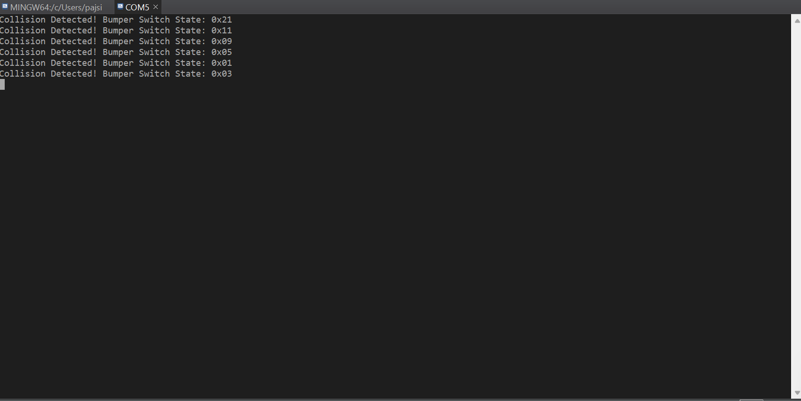
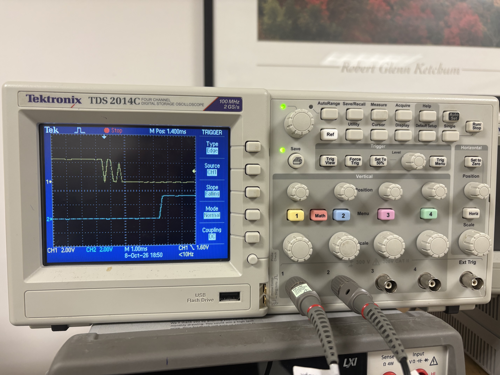

# ECE 528/L - Lab 1: Motor Control

**CSU Northridge**

**Department of Electrical and Computer Engineering**

## Overview

This lab uses PWM to control DC motors and servos with the MSP432 LaunchPad.
Timer_A0 controls the DC motors, and Timer_A2 controls the servos. The bumper
switches use interrupts to detect collisions. SysTick controls the chassis
LEDs based on the collision flag.
 
## Components Used

- TI MSP432P401R LaunchPad
- TI-RSLK MAX chassis and DC motors
- Left and right bumper switches
- Two HS-485HB servos
- Oscilloscope and probes
- Breadboard and jumper wires

## Analysis and Results

#### Servo PWM at 0 Degrees

Timer_A2 generates PWM signals on P5.6 and P5.7. The timer uses a 12 MHz
SMCLK divided by 2. In up/down mode, a period constant of 60000 gives a
20 ms period, or 50 Hz.

The 0-degree setting uses a compare value of 1700. The pulse-width photo
shows 580 us, which is within the lab's expected range of 540-580 us.

#### Servo PWM at 180 Degrees

The 180-degree setting uses a compare value of 7000. The PWM period stays
at 20 ms, while the longer pulse changes the servo position. The expected
pulse width is 2320-2360 us.

Measured pulse width: **[Insert the value from the retaken measurement.]**

#### Bumper Switches

The bumper switches are active low. Pressing a switch changes the input
from high to low, which triggers a Port 4 interrupt.

The ISR reads the switches and calls `Bumper_Switches_Handler()`. The
handler prints the switch state and sets `collision_detected` to 1.

The terminal output shows different bumper states. For example, 0x01
represents BMP0, while 0x03 represents BMP0 and BMP1 pressed together.

The oscilloscope capture shows the bumper input on CH1 and P8.7 on CH2.
The bumper input changes between high and low several times before
settling. This is switch bouncing. P8.7 goes high after the bumper event.

#### DC Motor Control

Timer_A0 generates the motor PWM signals on P2.6 and P2.7. It uses a
12 MHz SMCLK divided by 8. A period constant of 15000 gives a 20 ms
period in up/down mode.

The duty-cycle values used in the program are:

- 7500 for 50%
- 4500 for 30%
- 1500 for 10%

`Drive_Pattern_1()` moves the robot forward, left, right, and backward,
with stops between movements.

For collision handling, the main loop checks `collision_detected`.
When the flag is 1, `Handle_Collision()` performs this sequence:

1. Stop for 2 seconds.
2. Move backward at 30% duty cycle for 2 seconds.
3. Stop for 1 second.
4. Turn right at 10% duty cycle for 4 seconds.
5. Stop for 2 seconds.
6. Clear the collision flag.

The robot then resumes forward movement. During collision recovery,
SysTick turns on the rear red LEDs and turns off the front yellow LEDs.

## Known Issues or Limitations

- The bumper switches have no hardware debounce filter. One press can
  produce multiple falling edges.

## Author Contribution

I worked on the timer initialization, bumper switch initialization,
motor functions, and collision-handling code. I captured the scope
photos and terminal output and prepared the README
## References

- ECE 528/L Lab 1: Motor Control
- ECE 528 Unit 3: PWM and Motor Control
- [MSP432P4xx Technical Reference Manual](https://www.ti.com/lit/pdf/slau356)
- [MSP432P401R Datasheet](https://www.ti.com/lit/pdf/slas826)
- [Markdown Basic Syntax Guide](https://www.markdownguide.org/basic-syntax/)